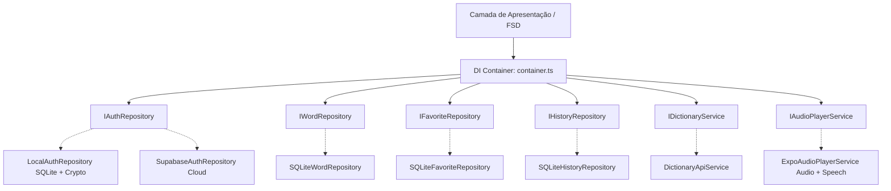

# 📚 Documentação Técnica dos Módulos (`src/modules/`)

Este documento descreve detalhadamente a arquitetura, responsabilidades, contratos e funções de cada módulo presente em `src/modules/`, explicando como eles se integram com o Container de Injeção de Dependências (`src/core/di/container.ts`), o banco de dados local SQLite e a camada de apresentação Feature-Sliced Design (FSD).

---

## 🏛️ Visão Geral da Arquitetura

O projeto adota os princípios de **Clean Architecture**, **SOLID** e **Inversão de Dependência (DIP)**:
- As camadas de **Domínio (`domain/`)** contêm as entidades puras e as interfaces de repositórios e serviços, sem nenhuma dependência de bibliotecas externas de banco ou rede.
- As camadas de **Infraestrutura (`infrastructure/`)** implementam essas interfaces interagindo diretamente com o SQLite (`expo-sqlite`), APIs REST, serviços de áudio (`expo-audio`, `expo-speech`) e autenticação segura (`expo-secure-store`, `expo-crypto`).
- As camadas de **Apresentação (`presentation/`)** contêm os estados globais gerenciados com Zustand, hooks do TanStack Query e componentes visuais desacoplados.

---

## 1. 🎵 Módulo de Áudio (`src/modules/audio/`)

Responsável pelo controle de reprodução da pronúncia das palavras do dicionário em inglês, com monitoramento contínuo de progresso e fallback resiliente.

### 📁 Estrutura de Arquivos

| Arquivo | Camada | Responsabilidade |
| :--- | :--- | :--- |
| `domain/audio-player.interface.ts` | Domínio | Contrato `IAudioPlayerService` e tipagens de status e callback de progresso |
| `infrastructure/expo-audio-player.service.ts` | Infraestrutura | Implementação nativa usando `expo-audio` e fallback automático para Text-to-Speech (`expo-speech`) |

### ⚙️ Detalhamento de Funções e Métodos

#### `IAudioPlayerService`
- **`playWord(word: string, audioUrl?: string, onProgress?: AudioProgressCallback): Promise<void>`**
  - Tenta reproduzir o arquivo de áudio remoto (`audioUrl`) fornecido pela Free Dictionary API usando o reprodutor nativo do `expo-audio`.
  - Notifica o callback `onProgress` com o percentual (0 a 1), milissegundos decorridos e estado de execução (`isPlaying`).
  - **Mecanismo de Resiliência (Fallback):** Caso a palavra não possua áudio gravado na API ou o áudio falhe, invoca automaticamente o sintetizador de voz nativo do dispositivo (`Speech.speak(word, { language: 'en-US' })`) através de `fallbackSpeech`, simulando a barra de progresso suavemente.
- **`stop(): Promise<void>`**
  - Interrompe imediatamente qualquer reprodução em andamento (seja do player de áudio ou do TTS) e limpa os intervalos de monitoramento.
- **`isPlaying(): boolean`**
  - Retorna o estado booleano atual de reprodução.

---

## 2. 🔐 Módulo de Autenticação (`src/modules/auth/`)

Responsável pela gestão de contas de usuário, login, cadastro, sessão de convidados (Guest Mode) e proteção de rotas.

### 📁 Estrutura de Arquivos

| Arquivo | Camada | Responsabilidade |
| :--- | :--- | :--- |
| `domain/entities/user.ts` | Domínio | Entidade de dados `User` (`id`, `name`, `email`, `createdAt`) |
| `domain/repositories/auth.repository.interface.ts` | Domínio | Contrato `IAuthRepository` com os métodos de autenticação |
| `infrastructure/local-auth.repository.ts` | Infraestrutura | Autenticação local em SQLite com hash SHA-256 + Salt único e persistência em `expo-secure-store` |
| `infrastructure/supabase-auth.repository.ts` | Infraestrutura | Driver pronto para integração com o Supabase Authentication |
| `presentation/state/useAuthStore.ts` | Apresentação | Store Zustand com controle de estado reativo do usuário, erros e sessão |
| `presentation/components/AuthGate.tsx` | Apresentação | Componente guardião que exige autenticação ou modo visitante antes de liberar a tela principal |
| `presentation/screens/AuthScreen.tsx` | Apresentação | Tela principal de login e cadastro com formulário acessível |
| `presentation/components/AuthModal.tsx` | Apresentação | Modal de autenticação para que visitantes possam criar conta sem perder o contexto |

### ⚙️ Detalhamento de Funções e Métodos

#### `LocalAuthRepository`
- **`signUp(email, password, name?): Promise<User>`**
  - Verifica se o e-mail já existe na tabela `users` do SQLite (com case-insensitive `COLLATE NOCASE`).
  - Gera um Salt criptográfico único por usuário (`expo-crypto.randomUUID()`).
  - Calcula o hash SHA-256 da senha combinada com o Salt (`digestStringAsync`).
  - Persiste o novo usuário no SQLite e grava o token de sessão criptografado no Keychain/Keystore via `expo-secure-store`.
- **`signIn(email, password): Promise<User>`**
  - Busca o usuário pelo e-mail, extrai o Salt armazenado, recalcula o hash e valida a senha.
  - Se válido, atualiza a chave de sessão ativa no `expo-secure-store`.
- **`signOut(): Promise<void>`**
  - Remove a chave de sessão do `expo-secure-store` com segurança.
- **`getCurrentUser(): Promise<User | null>`**
  - Lê a sessão persistida no `expo-secure-store` e valida se o registro ainda existe no SQLite ao iniciar o app.

#### `useAuthStore` (Zustand)
- **`initSession()`**: Inicia a verificação de sessão armazenada no boot da aplicação.
- **`signIn(email, pass)`**: Executa o login e atualiza o estado global `user`.
- **`signUp(email, pass, name?)`**: Cria nova conta e autentica imediatamente.
- **`continueAsGuest()`**: Ativa a flag `isGuest: true`, permitindo navegação livre sem credenciais.
- **`signOut()`**: Desconecta o usuário e redefine os estados.

---

## 3. 📖 Módulo de Dicionário (`src/modules/dictionary/`)

O módulo central do projeto, encarregado da navegação, listagem em 3 colunas com paginação infinita, favoritos, histórico e consulta à API externa.

### 📁 Estrutura de Arquivos

| Arquivo | Camada | Responsabilidade |
| :--- | :--- | :--- |
| `domain/entities/dictionary-word.ts` | Domínio | Entidades `WordDetail`, `Phonetic`, `Meaning`, `Definition`, `FavoriteItem` e `HistoryItem` |
| `domain/repositories/word.repository.interface.ts` | Domínio | Contrato `IWordRepository` para consulta e contagem de palavras |
| `domain/repositories/favorite.repository.interface.ts` | Domínio | Contrato `IFavoriteRepository` para adição, remoção e consulta de favoritos |
| `domain/repositories/history.repository.interface.ts` | Domínio | Contrato `IHistoryRepository` para histórico de visualizações |
| `domain/services/dictionary.service.interface.ts` | Domínio | Contrato `IDictionaryService` para busca externa de definições |
| `infrastructure/sqlite-word.repository.ts` | Infraestrutura | Repositório SQLite para listagem paginada e busca de palavras |
| `infrastructure/sqlite-favorite.repository.ts` | Infraestrutura | Repositório SQLite para favoritos isolados por usuário com `ON DELETE CASCADE` |
| `infrastructure/sqlite-history.repository.ts` | Infraestrutura | Repositório SQLite para histórico ordenado por data decrescente |
| `infrastructure/dictionary-api.service.ts` | Infraestrutura | Integração com a Free Dictionary API usando o cliente HTTP centralizado |
| `infrastructure/word-seeder.service.ts` & `seed-words.ts` | Infraestrutura | Carga e verificação de palavras iniciais do wireframe |
| `presentation/state/useWordStore.ts` | Apresentação | Store Zustand com paginação infinita, abas ativas, busca e favoritos |
| `presentation/hooks/useWordDetail.ts` | Apresentação | Hook TanStack Query (`useQuery`) com chave `['wordDetail', word]` e persistência |
| `presentation/screens/HomeScreen.tsx` | Apresentação | Tela principal que integra cabeçalho, abas, pesquisa e grelha de palavras |
| `presentation/components/WordGrid.tsx` | Apresentação | Grelha de 3 colunas com rolagem infinita (`FlatList`) |
| `presentation/components/TabBar.tsx` | Apresentação | Barra com as 3 abas exigidas no wireframe (`Word list`, `History`, `Favorites`) |
| `presentation/components/WordDetailModal.tsx` | Apresentação | Modal de detalhe com cartão fonético, áudio com progresso e significados |

### ⚙️ Detalhamento de Funções e Métodos

#### `SQLiteWordRepository`
- **`getWords(limit: number, offset: number, searchTerm?: string): Promise<string[]>`**
  - Executa consulta SQL indexada na tabela `words`.
  - Se `searchTerm` for fornecido, aplica `WHERE word LIKE ?%` para busca instantânea prefixada.
- **`countWords(): Promise<number>`**
  - Retorna o total de palavras cadastradas no banco local.
- **`populateInitialWords(words?: string[]): Promise<number>`**
  - Popula o banco local com um lote de palavras caso esteja vazio.

#### `SQLiteFavoriteRepository`
- **`addFavorite(userId: string, word: string): Promise<void>`**
  - Insere a palavra nos favoritos do usuário com timestamp ISO e ID único via `INSERT OR IGNORE`.
- **`removeFavorite(userId: string, word: string): Promise<void>`**
  - Remove a palavra associada ao `userId`.
- **`getFavorites(userId: string, limit, offset): Promise<string[]>`**
  - Recupera a lista de palavras favoritadas pelo usuário ordenadas pela data de adição.
- **`isFavorite(userId: string, word: string): Promise<boolean>`**
  - Checa se a palavra já está favoritada pelo usuário no banco local.

#### `SQLiteHistoryRepository`
- **`addToHistory(userId: string, word: string): Promise<void>`**
  - Registra a visualização da palavra com timestamp decrescente.
- **`getHistory(userId: string, limit, offset): Promise<HistoryItem[]>`**
  - Retorna as últimas palavras visualizadas ordenadas por `viewed_at DESC`.
- **`clearHistory(userId: string): Promise<void>`**
  - Limpa todo o histórico de visualizações do usuário.

#### `DictionaryApiService`
- **`fetchWordDetail(word: string): Promise<WordDetail | null>`**
  - Realiza requisição HTTP GET para `https://api.dictionaryapi.dev/api/v2/entries/en/{word}` através de `httpClient`.
  - Se a API retornar status 404, retorna `null` sem disparar exceção não tratada.
  - Extrai e normaliza fonéticas, áudios e significados com exemplos para a entidade `WordDetail`.

#### `useWordStore` (Zustand)
- **`loadInitialWords(term?)`**: Carrega o primeiro lote da página 1 (respeitando `pageSize = 30`).
- **`loadMoreWords()`**: Disparado pelo `onEndReached` da lista, incrementa a página e concatena os novos itens.
- **`setSearchTerm(term)`**: Atualiza o termo de busca com debounce e reseta a lista de palavras.
- **`selectWord(word)` / `selectNextWord()` / `selectPreviousWord()`**: Gerencia a palavra ativa em exibição e permite avançar ou retroceder pelas palavras da lista nos botões "Voltar" e "Próximo".
- **`toggleFavorite(userId, word)`**: Alterna o status de favorito de forma atômica no banco local e atualiza o estado em memória.
- **`recordWordView(userId, word)`**: Registra no histórico do SQLite ao abrir o modal de detalhes.

---

## 4. 🧩 Camada de Infraestrutura Global (`src/core/`)

| Módulo / Arquivo | Responsabilidade |
| :--- | :--- |
| `src/core/di/container.ts` | **Dependency Injection Container**: Instancia e provê todos os repositórios e serviços. Permite injetar mocks nos testes unitários e alternar entre banco local e Supabase com facilidade (`container.setAuthRepository(...)`). |
| `src/core/storage/database.ts` | **SQLite Core Engine**: Abre a conexão com `expo-sqlite`, executa as migrations (`CREATE TABLE IF NOT EXISTS` com índices e foreign keys) e ativa o modo WAL (`PRAGMA journal_mode = WAL`) para alta performance de leitura concorrente. |
| `src/core/network/query-client.ts` | **TanStack Query Setup**: Configura o cliente de queries com `staleTime` de 24h, `gcTime` de 7 dias, persistência offline-first via `createAsyncStoragePersister` e sincronização de foco com o ciclo de vida do app (`AppState`). |
| `src/core/ui/ErrorBoundary.tsx` | **Tratamento Global de Erros**: Captura exceções não tratadas de renderização, exibe tela amigável com tokens semânticos e botão para restabelecer a aplicação. |

---

## 5. 🎨 Relação com a Camada FSD (`src/shared/`, `src/entities/`, `src/features/`, `src/widgets/`)

Os módulos de negócio em `src/modules/` alimentam a arquitetura Feature-Sliced Design:
- **`src/shared/`**: Provê tokens semânticos de cores, espaçamentos e componentes de interface básicos (`Button`, `Input`, `Typography`, `EmptyState`, `httpClient`, `useDebounce`).
- **`src/entities/`**: Expõe os modelos e células atômicas reutilizáveis (`WordCell`, tipos de usuário e palavra).
- **`src/features/`**: Agrupa os fluxos de valor de negócio com subcomponentes de no máximo 120 linhas (`auth`, `word-detail`).
- **`src/widgets/`**: Monta os blocos de tela autônomos (`Header`, `SearchBar`, `TabBar`, `WordGrid`).
